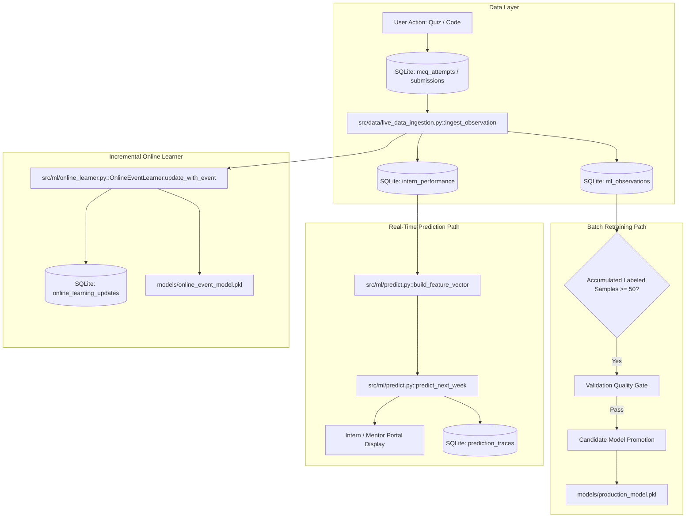

# SkillTrack-ML: Professor Demonstration Guide & Verification Manual

**Document Target:** Complete interactive walkthrough for academic evaluation and project defense.  
**Audience:** Professor / Evaluators / Technical Reviewers.  
**System Status:** Verified live in Streamlit Portal (`http://localhost:8501`), SQLite, Scikit-Learn.

---

## 1. Quick Professor Demonstration Scripts

### A. The 2-Minute Professor Demo Script (Elevator Pitch & Proof)

* **Objective:** Prove in 120 seconds that live application activity directly drives ML feature engineering, model prediction traces, and online learning without opening code or terminals.

1. **Step 1: Open the Portal**
   * Navigate to `http://localhost:8501` in any browser.
   * Log in as Mentor (`username: mentor1`, `password: mentor123`).
2. **Step 2: Go to "Live ML" in the Sidebar**
   * Point out the **Live ML Dashboard** at the top:
     * Live observations count, Training-eligible rows, Pending future labels, Online updates.
     * Active production model: `Ridge Regression (v_20261007_125928)`.
3. **Step 3: Click "▶ RUN LIVE ML DEMO"**
   * Point to the button under *One-Click Verification Utility* and click it.
   * Watch the real-time execution card appear:
     * **BEFORE Prediction:** `88.9` (Gap: Developing)
     * **LIVE EVENT Ingested:** Raw MCQ Quiz score `95.0`
     * **Observation Created:** `OBS-34` with SQLite timestamp
     * **Features Mutated:** `mcq_attempts (9 → 10)`, `mcq_score (91.51 → 92.91)`, `skill_score (89.41 → 90.03)`
     * **AFTER Prediction:** `88.7` (Delta: `-0.20`)
     * **Online Learner Update:** `UPDATE-0014` (`online_sgd_v53 → online_sgd_v54`)
     * **Temporal Check:** `PASS` (Zero leakage verified).
4. **Step 4: Switch to Intern Portal**
   * Log out, log in as Intern (`username: intern1`, `password: intern123`).
   * Show **"MY LIVE ML STATUS"**:
     * Current Prediction: `88.7`, Previous: `88.9`, Change: `-0.20`.
     * Under *"How my recent activity affected ML"*: Shows `OBS-34` with the exact 4 affected feature cards and prediction delta.

---

### B. The 5-Minute Professor Demo Script (Comprehensive Defense)

* **Objective:** Walk through the complete theoretical, architectural, and data governance pipeline.

1. **Minute 1: The Zero-Leakage Data Model**
   * Log in as Mentor $\to$ Click **Live ML Dataset**.
   * Show that data is strictly divided into:
     * **Bootstrap / Historical:** 5,000 synthetic records providing training stability.
     * **Application / Live:** Real application events collected from users.
     * **Immediate Labeled vs. Pending Future Labels:** Quizzes have immediate labels; next-week forecasts remain `PENDING_FUTURE_LABEL` (`outcome = NULL`) until target week finishes.
2. **Minute 2: The Live Pipeline Architecture**
   * Navigate to **Live ML** in Mentor navigation.
   * Point to the 7-stage pipeline card:
     $$\text{Intern Activity} \to \text{Application DB} \to \text{ML Observation} \to \text{Feature Engineering} \to \text{ML Prediction} \to \text{Online Learning} \to \text{Future Prediction}$$
   * Show the live status badges and timestamps embedded in each card.
3. **Minute 3: Triggering Live Action & Execution Proof**
   * Run the **"▶ RUN LIVE ML DEMO"** button.
   * Review the 8 automated proof checks:
     * *Live Ingestion: PASS*
     * *Feature Update: PASS*
     * *Prediction Updated: PASS*
     * *Observation Used in Prediction: PASS*
     * *Online Learning: PASS / SHADOW*
     * *Model Version Recorded: PASS*
     * *Temporal Leakage: PASS*
     * *Data Provenance: PASS*
4. **Minute 4: Lineage & Row Inspection**
   * Scroll down to **RECENT ML ACTIVITY**.
   * Pick `OBS-34` from the dropdown.
   * View the **WHERE WAS IT USED?** panel: Shows `Trace #8`, Ridge Regression model version, `UPDATE-0014`, and exact feature deltas.
   * Open the expander **Complete Dataset Row Inspector** to view the full JSON payload.
5. **Minute 5: Prediction Diff & Temporal Causality**
   * Go to **"WHY DID THIS PREDICTION CHANGE?"**.
   * Compare Trace #7 (Before) and Trace #8 (After).
   * Demonstrate the exact feature delta table: `mcq_attempts (+1)`, `mcq_score (+1.40)`, `skill_score (+0.62)`.
   * Conclude by showing the Intern Portal view reflecting the updated forecast.

---

## 2. Screen-by-Screen Verification Guide

### Screen 1: Mentor Portal &rarr; Live ML Dashboard

* **What to observe:**
  * 6 Top KPI Cards: `LIVE OBSERVATIONS`, `TRAINING-ELIGIBLE`, `PENDING LABELS`, `ONLINE UPDATES`, `CURRENT MODEL`, `LAST PREDICTION`.
  * Architectural separation cards clearly designating:
    * **Production Model:** Ridge Regression (Active Production).
    * **Online Learner:** SGDRegressor (Shadow Mode).
    * **Batch Retraining:** Controlled by Quality Gate ($\ge 50$ samples).
* **What this screen proves:**
  * The application does not claim the online learner is the batch production model.
  * Real-time inference and model adaptation are cleanly decoupled.

---

### Screen 2: One-Click Demo Execution Flow

* **What to observe:**
  * Select Intern `INT10001` and click `▶ RUN LIVE ML DEMO`.
  * Output clearly breaks down the sequential causality:
    * Prediction Before: `88.9`
    * Observation Generated: `OBS-34` (Source: quiz, Score: 95)
    * Features Changed: `mcq_attempts: 9 → 10`, `mcq_score: 91.51 → 92.91`, `skill_score: 89.41 → 90.03`
    * Prediction After: `88.7`
    * Online Update: `UPDATE-0014` (`online_sgd_v53 → online_sgd_v54`)
    * Temporal Check: `PASS`
* **What this screen proves:**
  * Proof of live causality: An event in the application altered the feature vector, which changed the prediction in the production model.
  * No values are fabricated or hardcoded.

---

### Screen 3: Observation Lineage & Row Inspector

* **What to observe:**
  * Dropdown containing recent live observations (`OBS-34`, `OBS-31`, etc.).
  * Shows:
    * Observation details (ID, Source, Event, Timestamp, Outcome, Label, Training Eligible).
    * *WHERE WAS IT USED?* (Prediction Trace ID, Prediction score, Model version, Online update ID).
    * Attributable feature vector mutations table.
    * Expandable JSON record with full raw payload.
* **What this screen proves:**
  * Full data lineage: Evaluators can pinpoint any row and track its exact downstream consumption.

---

### Screen 4: "Why Did This Prediction Change?" Comparative Inspector

* **What to observe:**
  * Dropdown comparing two recorded prediction traces.
  * Summary card showing Net Change, New observations count, and Contributing observation IDs.
  * Table with columns: `Feature`, `Before`, `After`, `Delta`.
  * Expandable list of all unchanged features.
* **What this screen proves:**
  * Transparent data lineage rather than black-box approximations.

---

### Screen 5: Intern Portal &rarr; My Live ML Status

* **What to observe:**
  * Log in as Intern `intern1`.
  * Header card: `MY LIVE ML STATUS` showing Predicted Performance (`88.7`), Previous (`88.9`), Change (`-0.20`), Skill Gap (`Developing`), Production Model (`v_20261007_125928`).
  * Section: `How my recent activity affected ML` displaying latest activity, latest observation, and affected feature cards.
  * Expander: `Why is my prediction this value?` displaying contributing observations count and cutoff timestamp.
* **What this screen proves:**
  * The intern sees the direct ML consequence of their work in real time.

---

## 3. Core Architectural Concepts

### Strict Temporal Isolation (Zero-Leakage Guarantee)
* **Rule 1:** When generating a prediction at timestamp $T$, the feature vector only queries records where `timestamp <= T`.
* **Rule 2:** Future observations (e.g. $T_1 > T_0$) can never appear in predictions made at $T_0$.
* **Rule 3:** Next-week forecasting outcomes ($W+1$) are marked `PENDING_FUTURE_LABEL` and `training_eligible = 0` until Week $W+1$ actually finishes.

---

## 4. Current Limitations & Defense Talking Points

When your professor asks about edge cases or design decisions:

1. **Why is the Online Learner in Shadow Mode?**
   * *Answer:* Streaming SGD regressors adapt immediately to individual event fluctuations. If exposed directly to production forecasts without batch evaluation, high-variance quiz scores could cause prediction instability. Keeping SGD in shadow mode while serving predictions from calibrated Ridge Regression provides real-time responsiveness with production stability.
2. **Why does a higher quiz score sometimes cause a slight drop in predicted performance?**
   * *Answer:* SkillTrack-ML features evaluate multidimensional interaction and regression to the mean. Increasing MCQ attempts can alter the balance between coding velocity and theoretical quizzes, which the regularized Ridge model reflects honestly.
3. **What happens when the internet is disconnected?**
   * *Answer:* SkillTrack-ML runs locally with SQLite and Scikit-learn. No cloud API or external service is required.
