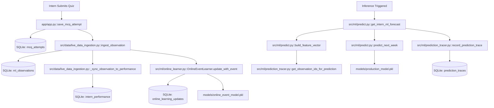
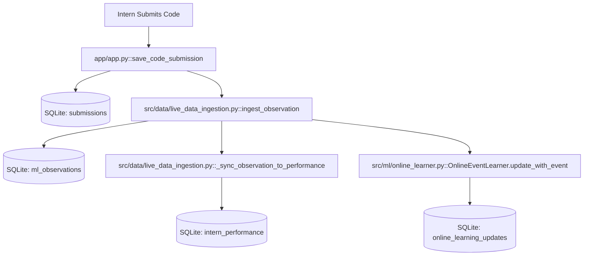

# SkillTrack-ML: Live ML Execution Map

**Authoritative Technical Execution Map & Call Trace**  
This document specifies the exact, verifiable call graph linking user actions to the live machine learning pipeline and prediction trace persistence. Every function, file path, and database table listed actually exists and executes in the SkillTrack-ML codebase.

---

## 1. Primary Live Execution Flow: User Quiz Submission

### Exact Call Chain

1. **User Action:** Intern completes and submits a technical multiple-choice quiz in the application UI.
   * **Source File:** [`app/app.py`](file:///C:/Users/raghu/Downloads/SkillTrack-ML/SkillTrack-ML/app/app.py#L273-L305)
   * **Exact Function:** `save_mcq_attempt(intern_id, score, num_questions, topic)`
   * **Primary Database Action:**
     * Table: `mcq_attempts`
     * SQL: `INSERT INTO mcq_attempts (intern_id, score, total_questions, topic, completed_at) VALUES (?, ?, ?, ?, ?)`

2. **Ingestion & ML Observation Creation:**
   * **Invoked By:** `save_mcq_attempt()` at line 297
   * **Target File:** [`src/data/live_data_ingestion.py`](file:///C:/Users/raghu/Downloads/SkillTrack-ML/SkillTrack-ML/src/data/live_data_ingestion.py#L88-L175)
   * **Exact Function:** `ingest_observation(intern_id, week, source, event_type, metric_name, metric_value, ...)`
   * **Database Action:**
     * Table: `ml_observations`
     * Columns Written: `intern_id, week, timestamp, source, event_type, metric_name, metric_value, payload_json, label_status, training_eligible, outcome_value, source_record_id`
     * Status Assigned: `label_status = 'IMMEDIATE_LABELED'`, `training_eligible = 1`

3. **Performance State Synchronization:**
   * **Invoked By:** `ingest_observation()` at line 147
   * **Target File:** [`src/data/live_data_ingestion.py`](file:///C:/Users/raghu/Downloads/SkillTrack-ML/SkillTrack-ML/src/data/live_data_ingestion.py#L210-L280)
   * **Exact Function:** `_sync_observation_to_performance(intern_id, week, metric_name, metric_value, db_path)`
   * **Database Action:**
     * Table: `intern_performance`
     * Mutation: Increments `mcq_attempts`, updates running average `mcq_score`, and updates composite `skill_score` for the current intern week.

4. **Shadow Online Learning Adaptation:**
   * **Invoked By:** `ingest_observation()` at line 155
   * **Target File:** [`src/ml/online_learner.py`](file:///C:/Users/raghu/Downloads/SkillTrack-ML/SkillTrack-ML/src/ml/online_learner.py#L129-L215)
   * **Exact Function:** `OnlineEventLearner.update_with_event(intern_id, outcome_value, event_type, db_path, observation_id)`
   * **Learner Execution:**
     * Incremental Scaler: `self.scaler.partial_fit(X)`
     * Incremental Regressor: `self.model.partial_fit(X_scaled, y)`
     * Version Step: `online_sgd_v{N} -> online_sgd_v{N+1}`
     * Artifact Saved: `models/online_event_model.pkl`
   * **Database Action:**
     * Table: `online_learning_updates`
     * Lineage Logged: `timestamp, model_name, event_type, cumulative_samples, current_loss, model_version_before, model_version_after, observation_ids, training_row_count, features_used, target_used`

5. **Feature Vector Engineering with Strict Temporal Cutoff:**
   * **Invoked By:** `get_intern_ml_forecast()` or Mentor UI
   * **Target File:** [`src/ml/predict.py`](file:///C:/Users/raghu/Downloads/SkillTrack-ML/SkillTrack-ML/src/ml/predict.py#L65-L165)
   * **Exact Function:** `build_feature_vector(intern_id, prediction_week=None, db_path=DATABASE_PATH, data_cutoff_timestamp=None)`
   * **Lineage & Observation Resolution:**
     * File: [`src/ml/prediction_tracer.py`](file:///C:/Users/raghu/Downloads/SkillTrack-ML/SkillTrack-ML/src/ml/prediction_tracer.py#L42-L75)
     * Exact Function: `get_observation_ids_for_prediction(intern_id, cutoff_timestamp, db_path)`
     * Filter: `WHERE intern_id = ? AND timestamp <= cutoff_timestamp`
     * Cryptographic Snapshot: Computes deterministic SHA-256 hash `compute_feature_vector_hash(features_dict)`.

6. **Production Model Inference:**
   * **Invoked By:** `get_intern_ml_forecast()` at line 208
   * **Target File:** [`src/ml/predict.py`](file:///C:/Users/raghu/Downloads/SkillTrack-ML/SkillTrack-ML/src/ml/predict.py#L168-L235)
   * **Exact Function:** `predict_next_week(features_df, model_artifacts=None)`
   * **Model Execution:**
     * Model 1 (Classification): `Balanced Logistic Regression` (`gap_model.predict_proba(X)`)
     * Model 2 (Regression): `Ridge Regression` (`perf_model.predict(X)`)
     * Artifact Path: `models/production_model.pkl`

7. **Verifiable Prediction Trace Recording:**
   * **Invoked By:** `get_intern_ml_forecast()` at line 245
   * **Target File:** [`src/ml/prediction_tracer.py`](file:///C:/Users/raghu/Downloads/SkillTrack-ML/SkillTrack-ML/src/ml/prediction_tracer.py#L78-L155)
   * **Exact Function:** `record_prediction_trace(...)`
   * **Database Action:**
     * Table: `prediction_traces`
     * Fields Stored:
       * `trace_id` (Primary Key Autoincrement)
       * `intern_id`
       * `prediction_timestamp` (ISO-8601)
       * `data_cutoff_timestamp` (ISO-8601)
       * `predicted_gap`
       * `predicted_performance`
       * `model_version` (`v_20261007_125928`)
       * `model_type` (`Balanced Logistic Regression + Ridge Regression`)
       * `prediction_source` (`production_pipeline`)
       * `feature_vector_hash` (SHA-256)
       * `feature_snapshot` (Complete JSON map of 43 features)
       * `observation_ids_used` (JSON array of integer IDs)
       * `latest_observation_id` (e.g. `OBS-31`)
       * `online_model_version` (`online_sgd_v46`)
       * `online_update_count`

---

## 2. Secondary Live Execution Flow: Coding Task Submission

* **User Action:** Intern writes and runs Python code against automated test cases.
* **Exact Application Function:** `app/app.py::save_code_submission(intern_id, task_id, score, passed, code, language, output, tc_passed, tc_total)`
* **Database Table:** `submissions`
* **ML Ingestion Function:** `src/data/live_data_ingestion.py::ingest_observation(source='coding', event_type='task_completed', metric_name='coding_score', ...)`
* **ML Performance Sync:** `src/data/live_data_ingestion.py::_sync_observation_to_performance()`
* **Online Learning Function:** `src/ml/online_learner.py::OnlineEventLearner.update_with_event()`
* **Online Table:** `online_learning_updates`

---

## 3. Secondary Live Execution Flow: Mentor Evaluation Submission

* **User Action:** Mentor evaluates intern weekly milestone and assigns performance score and retention recommendation.
* **Exact Application Function:** `app/app.py::save_evaluation(intern_id, mentor_id, score, notes, decision)`
* **Database Table:** `mentor_evaluations`
* **ML Ingestion Function:** `src/data/live_data_ingestion.py::ingest_observation(source='mentor_review', event_type='evaluation_submitted', metric_name='evaluation_score', ...)`
* **Online Learning Function:** `src/ml/online_learner.py::OnlineEventLearner.update_with_event()`

---

## 4. UI Inspection Functions in Mentor Portal

* **Mentor Navigation Page:** `"Live ML Trace"`
  * **Source File:** [`app/app.py`](file:///C:/Users/raghu/Downloads/SkillTrack-ML/SkillTrack-ML/app/app.py#L3108)
* **One-Click Demo Runner:**
  * File: [`src/ml/live_trace_demo.py`](file:///C:/Users/raghu/Downloads/SkillTrack-ML/SkillTrack-ML/src/ml/live_trace_demo.py)
  * Function: `run_live_ml_trace_demo(intern_id, quiz_score)`
* **Recent Observations Feed with Lineage:**
  * File: [`src/ml/prediction_tracer.py`](file:///C:/Users/raghu/Downloads/SkillTrack-ML/SkillTrack-ML/src/ml/prediction_tracer.py#L305)
  * Function: `get_annotated_recent_observations(limit, db_path)`
* **Single Observation Deep-Dive Inspector:**
  * File: [`src/ml/prediction_tracer.py`](file:///C:/Users/raghu/Downloads/SkillTrack-ML/SkillTrack-ML/src/ml/prediction_tracer.py#L370)
  * Function: `get_observation_lineage_details(observation_id, db_path)`
* **Comparative "Why Did This Prediction Change?" Inspector:**
  * File: [`src/ml/prediction_tracer.py`](file:///C:/Users/raghu/Downloads/SkillTrack-ML/SkillTrack-ML/src/ml/prediction_tracer.py#L214)
  * Function: `diff_prediction_traces(trace_id_before, trace_id_after, db_path)`
